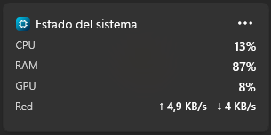
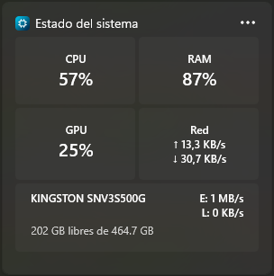
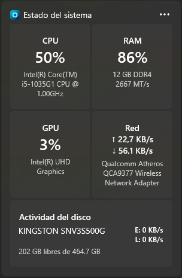

# System Info Widget

A Windows 11 [Widgets Board](https://learn.microsoft.com/windows/apps/design/widgets/) widget that shows real-time **CPU, RAM, GPU, network, and disk** usage. Built as a C# widget provider on the Windows Widgets Platform (Windows App SDK), rendered as an Adaptive Card, and packaged as MSIX.

## Screenshots

| Small | Medium | Large |
| --- | --- | --- |
|  |  |  |

## Features

- **Real-time metrics**: CPU and RAM usage, GPU busy percentage (plus VRAM when the adapter is dedicated), network upload/download throughput, and disk read/write throughput with free/total capacity.
- **Three widget sizes** (small, medium, large), each with a layout tuned to its available space — denser cards as the widget grows, not just the same content stretched out.
- **Multi-language UI** (English and Spanish) with automatic detection of the Windows system language, falling back to English when unsupported.
- **Hidden from the Start menu's app list** while still showing up in Settings > Apps and Task Manager, per the product requirement.
- **Resource-light**: polling only runs while the widget is actually pinned and visible on the Widgets Board (`Activate`/`Deactivate`), performance counters are opened once and reused instead of recreated every tick, and the process uses workstation GC tuned for the smallest working set.

## Architecture

Clean Architecture, outside-in:

```
src/
  WsSystemInfoWidget.Core/            Pure C# domain layer: models, enums, formatting,
                                       abstractions (ICpuUsageProvider, IGpuUsageProvider, …).
                                       No WinUI/COM/WinRT references.
  WsSystemInfoWidget.Infrastructure/   Real system-data providers behind the Core abstractions
                                       (PerformanceCounter, WMI, GlobalMemoryStatusEx).
  WsSystemInfoWidget.Widget/          The widget provider app: IWidgetProvider + COM class
                                       factory, Adaptive Card template/mapper, Package.appxmanifest.
tests/
  WsSystemInfoWidget.Core.Tests/
  WsSystemInfoWidget.Infrastructure.Tests/
```

- **Core** has no dependency on widget activation or packaging, so metric-correctness tests run without a deployed widget.
- **Infrastructure** implementations are swapped in behind Core's interfaces via `AddSystemInfoInfrastructure()`.
- **Widget** maps Core snapshots into the Adaptive Card JSON payload (`WidgetDataMapper`) sent to the Widgets Board; it never renders XAML directly — the widget surface itself is Adaptive Cards.
- MVVM is implemented with `CommunityToolkit.Mvvm`.

## Requirements

- Windows 11 with [Developer Mode](https://learn.microsoft.com/windows/advanced-settings/developer-mode) enabled.
- Visual Studio 2022 or later with the **Windows application development** workload (needed to build/deploy the MSIX package — `dotnet build` alone can build the Core/Infrastructure/test projects but not package or register the widget).
- .NET 10 SDK.

## Building

```sh
# Core, Infrastructure, and both test projects build with the SDK CLI:
dotnet build WsSystemInfoWidget.sln

# Deploying the widget provider itself (packaging + registration) requires
# Visual Studio: open WsSystemInfoWidget.sln, select the x64 or arm64
# platform, and press F5 (or Deploy) on the WsSystemInfoWidget.Widget project.
```

## Running tests

```sh
dotnet test WsSystemInfoWidget.sln
```

## Localization

UI strings live in `.resw` resource files per language under `Strings/<lang>/Resources.resw` (currently `en-US` and `es-ES`). The system UI language is detected at startup and resolved through `ILocalizationService`; code itself stays English-only, with every user-facing string routed through the localization layer.
